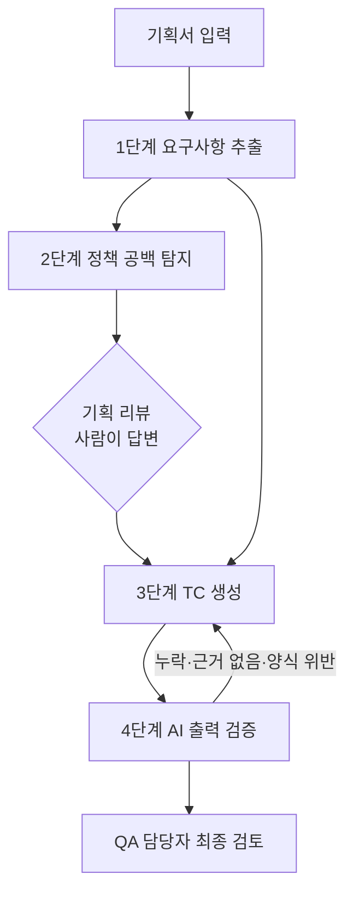

# 문제 4. 기획 리뷰 보조 도구: 정책 공백 탐지와 TC 초안 생성

## 1. 문제 정의

기획서로 TC를 설계할 때 시간이 가장 많이 들고, 놓쳤을 때 비용이 가장 큰 일은 두 가지입니다.

- **정책 공백 찾기:** 기획서에 정의되지 않은 조건(예외 상황, 상태가 겹치는 경우, 동시에 발생하는 경우)을 리뷰 단계에서 찾아내는 일
- **정책·예외 케이스 누락 방지:** 기획서 여러 곳에 흩어진 조건을 빠짐없이 TC로 옮기는 일

둘 다 담당자의 경험과 집중력에 의존합니다. 실무에서 모든 검증을 마치고 배포한 뒤, 기획·개발·QA 모두 인지하지 못했던 영향범위로 운영 이슈가 발생한 경험이 있습니다. 돌아보면 TC를 잘못 만든 것이 아니라, **기획서에 없던 정책을 아무도 몰랐던 것**이 원인이었습니다. 기획서에 없는 정책은 TC에도 들어갈 수 없습니다. 이후 사전 QA 영향범위 검토 리뷰를 도입해 재발을 막았지만, 검토 자체는 여전히 사람이 처음부터 읽어가며 해야 하는 작업입니다.

그래서 이 도구의 목적은 TC 작성 시간을 줄이는 것보다 **기획 리뷰 단계에서 정책 공백을 한 번 더 걸러내는 것**에 둡니다. 핵심 결과물은 기획·개발에 확인할 질문 목록이고, TC 초안은 그 답변을 반영한 다음 단계의 결과물입니다. 판단은 사람이 하고, 도구는 놓치기 쉬운 부분을 미리 펼쳐 보여주는 역할입니다.

## 2. 기존 접근과의 차이

기획서로 TC를 생성하는 도구는 많은 팀이 시도하는 주제입니다. 이 도구는 아래 세 가지에서 다르게 접근합니다.

| 흔한 접근 | 이 도구 |
|---|---|
| 기획서가 완성돼 있다고 가정하고 TC를 생성 | 기획서가 불완전하다고 가정하고 공백부터 찾음 |
| 결과물이 TC | 핵심 결과물이 기획 리뷰용 질문 목록, TC는 그 다음 |
| 써 보고 "좋아졌다"는 체감으로 평가 | 과거에 놓친 사례를 정답셋으로 도구 자체를 회귀 테스트 |

- **작동 시점이 다릅니다.** TC 작성 단계가 아니라 기획 리뷰 전 단계에서 작동하므로, 공백이 개발에 들어가기 전에 정책으로 확정됩니다.
- **도구도 테스트 대상으로 봅니다.** AI 결과가 믿을 만한지를 정답셋으로 측정하고, 도구를 바꿀 때마다 같은 정답셋으로 다시 확인합니다. 문제 2에서 버그 모드로 "테스트가 버그를 잡는지"를 확인한 것과 같은 방식입니다.
- **팀의 리뷰 노하우가 쌓입니다.** 사람이 리뷰에서 찾았지만 도구가 놓친 공백은 정답셋과 관점 목록에 추가합니다. 도구를 쓸수록 팀이 실제로 겪은 공백 유형이 반영됩니다.

## 3. 도구 개요

| 입력 | 출력 |
|---|---|
| 기획서 텍스트 (Confluence 문서, 정책 표 등) | ① 요구사항 목록 (ID 부여) ② **정책 공백 질문 목록 (기획 리뷰용, 핵심 결과물)** ③ TC 초안 (요구사항 ID와 연결) ④ 검증 리포트 (누락·근거 없음·양식 위반) |

## 4. 동작 구조

### 1단계: 요구사항 추출

기획서를 읽어 검증 가능한 규칙 단위로 쪼개고 ID를 붙입니다. 각 요구사항에는 **기획서 원문 인용**을 함께 남깁니다. 이후 모든 단계가 이 ID를 기준으로 연결되므로, 원문에 없는 내용이 끼어들었는지 추적할 수 있습니다.

- 프롬프트: [prompts/01_extract_requirements.md](./prompts/01_extract_requirements.md)

### 2단계: 정책 공백 탐지

요구사항 목록을 정해진 관점으로 훑어 "기획서만으로는 답할 수 없는 질문"을 만듭니다. 막연히 "빠진 게 있나?"를 묻지 않고, 아래 관점을 하나씩 대입하게 해서 결과가 매번 비슷한 품질로 나오게 합니다.

| 관점 | 질문 예 |
|---|---|
| 경계값 | 수량·금액·시간이 0, 최대치, 초과일 때 |
| 상태 전이 | 이미 처리된 상태에서 같은 동작을 다시 하면 |
| 동시 발생 | 두 동작이 동시에 들어오면 무엇이 먼저인가 |
| 실패·취소 | 중간에 실패하거나 취소되면 이미 바뀐 값은 |
| 권한·주체 | 고객·사장님·운영자가 같은 대상을 바꾸면 |
| 영향범위 | 이 변경이 다른 화면·주문·정산에 반영되는가 |

결과는 기획 리뷰 전에 기획·개발에 공유할 질문 목록입니다. 답변을 받으면 요구사항에 추가합니다.

- 프롬프트: [prompts/02_find_policy_gaps.md](./prompts/02_find_policy_gaps.md)

### 3단계: TC 생성

요구사항과 리뷰 답변을 바탕으로 TC를 만듭니다. 팀의 TC 작성 규칙(한 TC에 예상결과 하나, 체언형 예상결과, 번호 줄바꿈 등)을 프롬프트에 명시하고, **모든 TC에 근거 요구사항 ID를 붙이게** 합니다.

- 프롬프트: [prompts/03_generate_tc.md](./prompts/03_generate_tc.md)

### 4단계: AI 출력 검증

AI가 만든 결과를 그대로 믿지 않고 사람이 보기 전에 한 번 더 걸러냅니다.

| 검증 | 방법 | 걸리면 |
|---|---|---|
| 누락 | 모든 요구사항 ID가 TC 1건 이상에 연결됐는지 대조 | 해당 요구사항만 다시 TC 생성 |
| 근거 없음 | TC의 근거 ID가 실제 요구사항 목록에 있는지 대조 | 근거 없는 TC는 "검토 필요"로 분리 |
| 양식 위반 | 예상결과가 하나인지, 체언형인지, 필수 열이 비었는지 | 자동 수정 요청 또는 표시 |
| 내용 오류 | 별도 검토 프롬프트가 요구사항 원문과 TC를 비교 | 불일치 사유와 함께 표시 |

누락·근거 없음·양식 검사는 규칙으로 판정할 수 있어 코드로 처리하고, 내용 오류만 검토용 프롬프트로 확인합니다. AI가 AI를 검증할 때 생기는 오판을 줄이기 위해, 규칙으로 판정 가능한 것은 규칙으로 처리하는 것이 원칙입니다.

- 프롬프트: [prompts/04_review_tc.md](./prompts/04_review_tc.md)

## 5. 적용 예시: 문제 2의 재고 처리 규칙

문제 2를 풀 때 재고 처리 규칙 표만으로는 결정할 수 없어서 직접 정한 정책이 4가지 있었습니다. 이 도구의 2단계가 같은 공백을 찾아내는지가 첫 번째 평가 기준이 됩니다.

| 직접 찾은 공백 | 해당 관점 |
|---|---|
| 재고보다 많은 수량을 주문하면 전량 거부인가, 가능한 만큼인가 | 경계값 |
| 이미 취소된 주문을 다시 취소하면 어떻게 응답하는가 | 상태 전이 |
| 운영자 재고 수정 중에 주문이 들어오면 무엇이 먼저인가 | 동시 발생 |
| 운영자 재고 수정은 어떤 경로(API)로 하는가 | 권한·주체 |

## 6. 도입과 평가

- **도입 순서:** 사전 QA 영향범위 검토 리뷰 대상 과제(검증 일정 3일 이상)에 먼저 적용합니다. 기획 리뷰 전에 1·2단계를 돌려 질문 목록을 만들고, 리뷰 후 3·4단계로 TC 초안을 만듭니다.
- **정답셋 기반 회귀 검증:** 도구가 믿을 만한지 먼저 확인한 뒤 도입합니다.
  - 정답셋 구성: 문제 2에서 직접 찾은 공백 4가지, 과거 회고·핫픽스 건 중 "기획 단계에서 놓친 정책" 사례 (고객·사내 민감 정보는 제거)
  - 측정: 정답셋의 기획서를 도구에 넣었을 때 알려진 공백을 몇 개 찾아내는지 (재현율), 쓸모없는 질문이 얼마나 섞이는지 (정밀도)
  - 운영: 프롬프트나 모델을 바꿀 때마다 같은 정답셋으로 다시 측정해, 성능이 떨어지면 반영하지 않습니다
  - 축적: 리뷰에서 사람이 찾았지만 도구가 놓친 공백은 정답셋과 2단계 관점 목록에 추가합니다
- **평가 지표:**
  - 공백 탐지: 사람이 리뷰에서 찾은 공백 중 도구가 미리 찾은 비율
  - 누락: 배포 후 발견된 이슈 중 TC 누락이 원인인 건수
  - 효율: TC 초안 작성 시간, 초안 중 수정 없이 채택된 TC 비율
- **사람의 역할:** 공백 질문의 우선순위를 정하고, 최종 TC를 채택합니다. 도구 결과는 초안이며 그대로 배포 판단에 쓰지 않습니다.

## 7. 한계와 대응

| 한계 | 대응 |
|---|---|
| 기획서에 없는 내용을 그럴듯하게 만들어냄 | 모든 출력에 원문 인용·요구사항 ID를 강제하고, 4단계에서 근거 없는 항목을 분리 |
| 화면 이미지(Figma)나 표의 서식 정보를 놓침 | 텍스트 기획서부터 적용. 이미지는 담당자가 요약을 덧붙임 |
| 사내 정책·도메인 용어를 모름 | 도메인 용어집과 기존 TC 예시를 프롬프트에 함께 제공 |
| 사내 문서를 외부 AI에 입력하는 보안 문제 | 사내 승인된 AI 환경에서만 사용. 개인정보·고객 데이터는 입력 대상에서 제외 |
